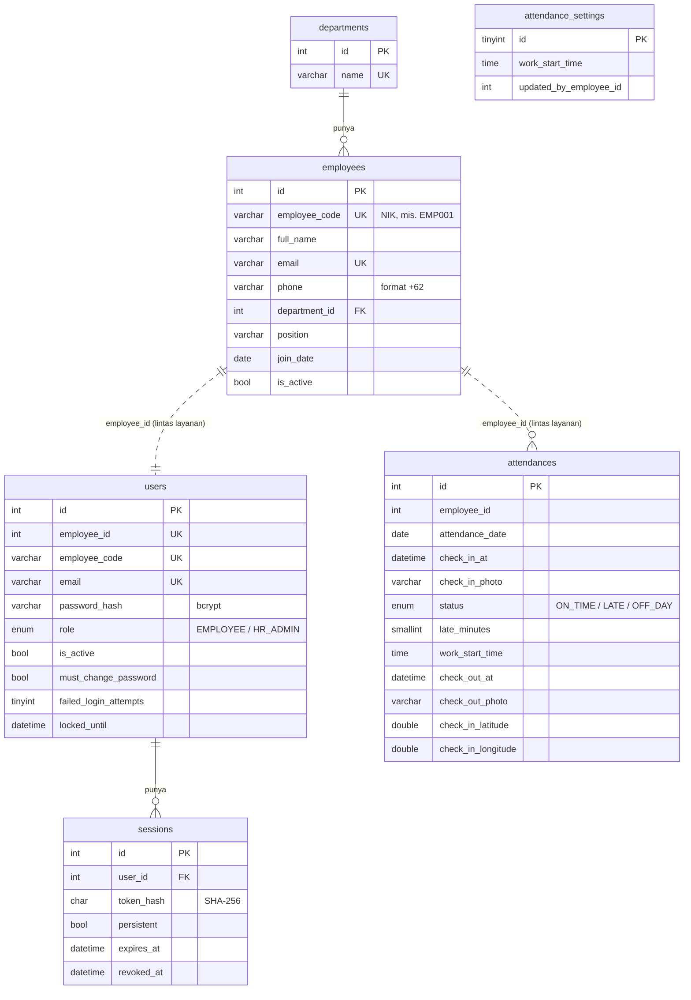

# Sistem Absensi WFH Dexa Group

Aplikasi absensi kerja dari rumah (WFH) untuk Fullstack Developer Skill Test Dexa Group.

- **Karyawan** check-in dan check-out dengan foto langsung dari kamera. Jam dicatat oleh server, lokasi ikut dicatat jika diizinkan.
- **Admin HR** mengelola data karyawan dan memantau absensi (hanya melihat, tidak bisa mengubah absensi).

| Bagian | Teknologi |
|---|---|
| Backend | NestJS 11 (TypeScript), arsitektur microservices dengan transport TCP |
| Database | MySQL 8.4, TypeORM dengan migration |
| Frontend | React 19, Vite, TanStack Query, Tailwind CSS 4, GSAP |
| Lainnya | Docker (untuk MySQL), Jest, Swagger |

---

## Daftar isi

1. [Cara menjalankan](#cara-menjalankan)
2. [Akun untuk mencoba](#akun-untuk-mencoba)
3. [Alur untuk dicoba](#alur-untuk-dicoba)
4. [Arsitektur](#arsitektur)
5. [Struktur database](#struktur-database)
6. [Daftar API](#daftar-api)
7. [Keputusan desain](#keputusan-desain)
8. [Keamanan](#keamanan)
9. [Pengujian](#pengujian)
10. [Struktur folder](#struktur-folder)
11. [Yang belum dibuat](#yang-belum-dibuat)

---

## Cara menjalankan

### Yang perlu disiapkan

- **Node.js 22 atau lebih baru** (dikembangkan dengan Node 24)
- **MySQL 8**, pilih salah satu:
  - **Docker Desktop** (disarankan): MySQL langsung jalan dengan satu perintah, tanpa instalasi
  - **MySQL yang sudah terpasang** di komputer (misalnya lewat Laragon, XAMPP, atau installer resmi)
- Browser modern (Chrome, Edge, Firefox) dan **kamera** untuk check-in

### 1. Siapkan file konfigurasi

```bash
cp .env.example .env
```

Isi bawaan `.env.example` sudah cocok untuk dijalankan di komputer sendiri. Untuk keamanan, ganti `JWT_SECRET` dengan teks acak yang panjang.

### 2. Jalankan MySQL

**Pilihan A, dengan Docker:**

```bash
docker compose up -d
```

Database `dexa_absensi` beserta user `dexa` dibuat otomatis dari isi `.env`.

**Pilihan B, tanpa Docker:** buat database dan user di MySQL Anda sesuai isi `.env`:

```sql
CREATE DATABASE dexa_absensi;
CREATE USER 'dexa'@'%' IDENTIFIED BY 'dexa_secret';
GRANT ALL PRIVILEGES ON dexa_absensi.* TO 'dexa'@'%';
```

### 3. Jalankan backend

```bash
cd backend
npm install
npm run db:setup
npm run dev
```

- `db:setup` menjalankan migration (membuat tabel) lalu seed (mengisi departemen dan akun contoh). Aman dijalankan ulang.
- `dev` menjalankan empat program sekaligus: API gateway dan tiga microservice.

### 4. Jalankan frontend

Di terminal lain:

```bash
cd frontend
npm install
npm run dev
```

### 5. Buka aplikasinya

| Aplikasi | Alamat |
|---|---|
| Aplikasi karyawan | http://localhost:5173 |
| Aplikasi HR | http://localhost:5174 |
| Dokumentasi API (Swagger) | http://localhost:3000/api/docs |
| Cek kesehatan layanan | http://localhost:3000/api/health |

> **Catatan:** di `localhost`, kedua aplikasi memakai sesi login yang sama dalam satu browser (cookie tidak dibedakan per port). Untuk mencoba akun karyawan dan HR bersamaan, buka salah satunya di **jendela incognito**.

---

## Akun untuk mencoba

Semua akun contoh memakai password **`Password123!`**. Login bisa dengan email atau NIK.

| Nama | Email | NIK | Peran |
|---|---|---|---|
| Rina Wijaya | hr@dexa.test | EMP001 | Admin HR (bisa memakai kedua aplikasi) |
| Budi Santoso | budi@dexa.test | EMP002 | Karyawan |
| Siti Rahmawati | siti@dexa.test | EMP003 | Karyawan |
| Andi Pratama | andi@dexa.test | EMP004 | Karyawan |
| Dewi Lestari | dewi@dexa.test | EMP005 | Karyawan |

Untuk mengembalikan akun-akun ini ke keadaan awal (password, status aktif, kunci login), jalankan `npm run db:seed` di folder `backend`.

---

## Alur untuk dicoba

**Sebagai karyawan** (http://localhost:5173, login sebagai `siti@dexa.test`):

1. Halaman **Hari ini** menampilkan jam server, penggaris waktu dengan garis jam masuk 09.00, dan kalimat seperti "Lewat 15 mnt dari jam masuk".
2. Tekan **Check-in sekarang**, izinkan kamera, ambil foto (bisa diulang), tambahkan catatan, lalu **Kirim check-in**. Status langsung tercatat: tepat waktu atau terlambat.
3. Buka **Riwayat** untuk melihat absensi per bulan. Tekan satu hari untuk melihat foto dan lokasinya.
4. Kembali ke **Hari ini** dan lakukan **Check-out** dengan foto.

**Sebagai HR** (http://localhost:5174 di jendela incognito, login sebagai `EMP001`):

1. Halaman **Absensi** menampilkan jumlah tepat waktu, terlambat, dan belum absen, grafik sebaran jam check-in, dan daftar semua karyawan. Tekan baris Siti untuk melihat foto, lokasi, dan catatannya.
2. Di **Pengaturan**, ubah jam masuk (misalnya ke 17:00). Check-in berikutnya dinilai dengan jam baru, sedangkan absensi lama tidak berubah.
3. Di **Karyawan**, tambahkan karyawan baru. Sistem membuat NIK dan **password sementara** yang hanya ditampilkan sekali.
4. Login sebagai karyawan baru itu di aplikasi karyawan. Ia **wajib mengganti password** sebelum bisa melakukan apa pun.
5. Coba juga reset password, jadikan admin HR, nonaktifkan, dan aktifkan kembali karyawan.

---

## Arsitektur

```
 Aplikasi karyawan (5173) ─┐
                           ├─► API gateway (HTTP 3000) ──TCP──► auth-service       (4001) ─┐
 Aplikasi HR (5174) ───────┘                              ├────► employee-service   (4002) ─┼─► MySQL
                                                          └────► attendance-service (4003) ─┘
```

**API gateway** adalah satu-satunya pintu masuk HTTP. Tugasnya:

- memeriksa token login dan peran (karyawan atau HR),
- memvalidasi input dan file foto,
- meneruskan permintaan ke layanan yang tepat lewat pesan TCP,
- mengubah error dari layanan menjadi status HTTP yang benar.

Tiga **microservice** tidak bisa diakses dari browser. Masing-masing hanya mendengarkan pesan TCP dari gateway dan hanya mengelola tabelnya sendiri:

| Layanan | Tanggung jawab | Tabel |
|---|---|---|
| auth-service | Login, sesi, password, akun | `users`, `sessions` |
| employee-service | Data karyawan, NIK, departemen | `employees`, `departments` |
| attendance-service | Check-in/out, foto, aturan terlambat, pengaturan jam masuk | `attendances`, `attendance_settings` |

Nama pesan TCP (misalnya `attendance.checkIn`) disimpan di satu file bersama, `backend/libs/common/src/constants/message-patterns.ts`, sehingga pengirim dan penerima selalu cocok.

**Contoh alur check-in:**

1. Tombol di aplikasi karyawan mengirim `POST /api/attendance/check-in` berisi foto, catatan, dan lokasi.
2. Gateway memeriksa token, memastikan file benar-benar gambar JPEG/PNG (maksimal 2 MB), dan memvalidasi isian.
3. Gateway bertanya ke employee-service apakah karyawan masih aktif dan kapan tanggal bergabungnya.
4. Gateway mengirim pesan `attendance.checkIn` ke attendance-service.
5. attendance-service mengambil jam server, menerapkan aturan terlambat, menyimpan foto, dan menulis ke database.
6. Hasilnya kembali ke gateway, lalu ke browser, dan layar langsung diperbarui.

**Dua aplikasi frontend, satu pustaka komponen.** Aplikasi karyawan dan aplikasi HR dibangun terpisah dari komponen bersama di `frontend/packages/shared-ui`: tombol, isian, dialog, halaman login, kerangka loading, dan sebagainya. Kode layar HR tidak ikut terbawa ke aplikasi karyawan.

---

## Struktur database



- **Garis tegas** adalah foreign key sungguhan di dalam satu layanan (`employees.department_id`, `sessions.user_id`).
- **Garis putus-putus** adalah referensi lintas layanan, tanpa foreign key, karena setiap layanan memiliki tabelnya sendiri. Konsistensinya dijaga oleh gateway: jika pembuatan akun login gagal setelah data karyawan tersimpan, data karyawan itu dihapus kembali (*compensating action*).
- Satu karyawan hanya punya **satu baris absensi per hari** (unique index `employee_id + attendance_date`). Check-in dan check-out ada di baris yang sama.
- Foto disimpan sebagai file di `backend/uploads/` dengan nama acak. Database hanya menyimpan lokasinya.
- Skema dibuat dengan **migration** (`backend/database/migrations`), bukan sinkronisasi otomatis.

---

## Daftar API

Semua alamat diawali `/api`. Dokumentasi lengkap yang bisa langsung dicoba ada di **Swagger**: http://localhost:3000/api/docs.

| Metode | Alamat | Akses | Fungsi |
|---|---|---|---|
| POST | `/auth/login` | Publik | Login dengan email atau NIK |
| POST | `/auth/refresh` | Publik (cookie) | Memperbarui access token |
| POST | `/auth/logout` | Publik (cookie) | Mengakhiri sesi di perangkat ini |
| POST | `/auth/change-password` | Login | Mengganti password |
| GET | `/auth/me` | Login | Profil pengguna yang login |
| GET | `/attendance/today` | Login | Absensi hari ini dan jam server |
| POST | `/attendance/check-in` | Login | Check-in dengan foto |
| POST | `/attendance/check-out` | Login | Check-out dengan foto |
| GET | `/attendance/me` | Login | Riwayat absensi sendiri |
| GET | `/attendance/settings` | Login | Jam masuk yang berlaku |
| GET | `/attendance/:id/photos/:kind` | Login | Foto absensi (milik sendiri, atau semua untuk HR) |
| GET | `/attendance/monitoring` | HR | Absensi semua karyawan pada satu tanggal |
| GET | `/attendance/employees/:id` | HR | Riwayat absensi satu karyawan |
| PUT | `/attendance/settings` | HR | Mengubah jam masuk |
| GET | `/employees` | HR | Daftar karyawan (cari, saring, halaman) |
| GET | `/employees/:id` | HR | Detail karyawan beserta status akun |
| POST | `/employees` | HR | Menambah karyawan dan akun login |
| PATCH | `/employees/:id` | HR | Mengubah data karyawan |
| PATCH | `/employees/:id/role` | HR | Mengubah peran |
| POST | `/employees/:id/deactivate` | HR | Menonaktifkan karyawan |
| POST | `/employees/:id/reactivate` | HR | Mengaktifkan kembali |
| POST | `/employees/:id/reset-password` | HR | Membuat password sementara baru |
| GET | `/departments` | HR | Daftar departemen |
| GET | `/health` | Publik | Status gateway dan ketiga layanan |

---

## Keputusan desain

| Keputusan | Alasan |
|---|---|
| **Tidak ada pendaftaran mandiri.** HR menambahkan karyawan, sistem membuat NIK dan password sementara. | Seperti sistem HR pada umumnya: yang boleh absen hanya karyawan yang terdaftar resmi. |
| **Password sementara wajib diganti** saat login pertama. | HR tidak pernah mengetahui password akhir karyawan. |
| **Lupa password = minta reset ke HR.** | Tidak butuh server email untuk tes ini. Pengembangan lanjutan ada di bagian akhir. |
| **Login dengan email atau NIK**, pilihan "Percayai perangkat ini selama 7 hari". | Karyawan absen setiap hari, jadi tidak perlu login ulang terus-menerus di perangkat pribadinya. |
| **Foto hanya dari kamera langsung**, tanpa pilihan dari galeri. Nama, NIK, dan jam dicetak di foto. | Foto lama atau foto orang lain tidak bisa dipakai sebagai bukti. |
| **Jam dicatat oleh server**, bukan dari perangkat. | Jam di HP bisa diubah oleh pengguna. |
| **Lokasi ikut dicatat jika diizinkan**, tetapi tidak wajib. | Menambah bukti bagi HR tanpa menghalangi karyawan yang menolak izin lokasi. |
| **Jam masuk 09.00 tanpa toleransi**, bisa diubah HR kapan saja. | Satu aturan yang jelas. Jika butuh kelonggaran, HR cukup menggeser jam masuk. |
| **Status terlambat disimpan saat check-in**, beserta jam masuk yang berlaku saat itu. | Mengubah jam masuk tidak mengubah penilaian absensi yang sudah ada. |
| **Senin sampai Jumat** dihitung hari kerja. Check-in di akhir pekan tetap bisa, tanpa status terlambat. | Karyawan yang lembur tetap tercatat, tanpa dianggap tidak hadir di hari libur. |
| **Check-out hanya di hari yang sama.** Jika lupa, absensi tetap tercatat tanpa check-out. | Tidak ada jam pulang yang dikarang-karang. |
| **Absensi tidak bisa diubah atau dihapus oleh HR.** | Sesuai soal: HR hanya melihat. Tidak ada jalan untuk memalsukan catatan. |
| **Karyawan dinonaktifkan, bukan dihapus.** | Riwayat absensinya tetap ada, dan akunnya bisa diaktifkan kembali. |
| **HR juga absen** lewat aplikasi karyawan. | Admin HR juga karyawan. |

Arah tampilan (warna, huruf, gerak, alasan tiap pilihan) dijelaskan di [DESIGN.md](DESIGN.md).

---

## Keamanan

- **Password** di-hash dengan bcrypt. Minimal 8 karakter, mengandung huruf dan angka.
- **Access token** (JWT) berlaku 15 menit dan hanya disimpan di memori browser, tidak di localStorage.
- **Refresh token** disimpan di cookie `httpOnly` dan `SameSite=strict`, jadi tidak bisa dibaca JavaScript. Token ini berganti setiap kali dipakai. Jika token lama dipakai lagi (tanda dicuri), sesinya langsung dimatikan.
- **Sesi bisa dicabut:** logout, ganti password, ganti peran, atau penonaktifan langsung mengakhiri sesi terkait.
- **Kunci akun 15 menit** setelah 5 kali salah password. Pesan error tidak membedakan "akun tidak ada" dan "password salah".
- **Pembatasan jumlah permintaan:** login maksimal 10 kali per menit per alamat IP.
- **Peran diperiksa di backend** untuk setiap rute HR (balasan 403), bukan hanya disembunyikan di tampilan.
- **Upload foto** diperiksa dari isi file (bukan nama file), maksimal 2 MB, disimpan dengan nama acak, dan hanya bisa diambil oleh pemiliknya atau HR.
- **Header keamanan** dengan Helmet, dan **CORS** hanya untuk alamat kedua aplikasi frontend.
- **Input** divalidasi dengan DTO. Isian yang tidak dikenal dibuang, sehingga misalnya peran tidak bisa diselundupkan lewat form.

---

## Pengujian

Di folder `backend`:

```bash
npm test
```

Menjalankan 67 unit test: aturan terlambat, zona waktu WIB, login dan penguncian akun, pembuatan NIK, format nomor HP, deteksi jenis gambar, dan aturan password.

```bash
npm run test:e2e
```

Menjalankan 14 test end-to-end yang menyalakan gateway dan ketiga layanan sungguhan, dengan database terpisah (`dexa_absensi_test`) yang dibuat ulang setiap kali. Membutuhkan MySQL yang menyala dan `MYSQL_ROOT_PASSWORD` di `.env`.

Pemeriksaan kode:

```bash
npm run lint
```

Di folder `frontend`, pemeriksaan tipe dan build:

```bash
npm run typecheck
```

```bash
npm run build
```

---

## Struktur folder

```
.
├── backend/
│   ├── apps/
│   │   ├── api-gateway/          pintu masuk HTTP, validasi, guard, Swagger
│   │   ├── auth-service/         login, sesi, akun
│   │   ├── employee-service/     karyawan dan departemen
│   │   └── attendance-service/   absensi, foto, aturan terlambat
│   ├── libs/common/              kontrak pesan, enum, utilitas bersama
│   ├── database/                 data source dan migration
│   ├── scripts/seed.ts           data contoh
│   └── test/                     test end-to-end
├── frontend/
│   ├── apps/
│   │   ├── employee-web/         aplikasi karyawan
│   │   └── hr-web/               aplikasi HR
│   └── packages/shared-ui/       komponen dan logika bersama
├── docker-compose.yml            MySQL
├── .env.example                  contoh konfigurasi
└── DESIGN.md                     arah tampilan
```

---

## Yang belum dibuat

Hal-hal berikut sengaja di luar cakupan tes ini, tetapi strukturnya sudah disiapkan:

- **Undangan dan lupa password lewat email**, melalui layanan notifikasi terpisah, sebagai pengganti password sementara dari HR.
- **Jadwal per karyawan atau per tanggal**, seperti setengah hari, hari libur nasional, atau acara kantor.
- **Pengajuan koreksi absensi** dengan persetujuan HR, misalnya untuk lupa check-out.
- **Penyimpanan foto di cloud** (misalnya S3). Penyimpanan foto sudah dipisah dalam satu kelas sehingga mudah diganti.
- **Verifikasi wajah atau batas lokasi** untuk bukti WFH yang lebih kuat.
- **Ekspor laporan** absensi ke CSV atau Excel.
- **Mode gelap.**
- **Satu perintah Docker** untuk menjalankan seluruh sistem (backend, frontend, dan database sekaligus).
